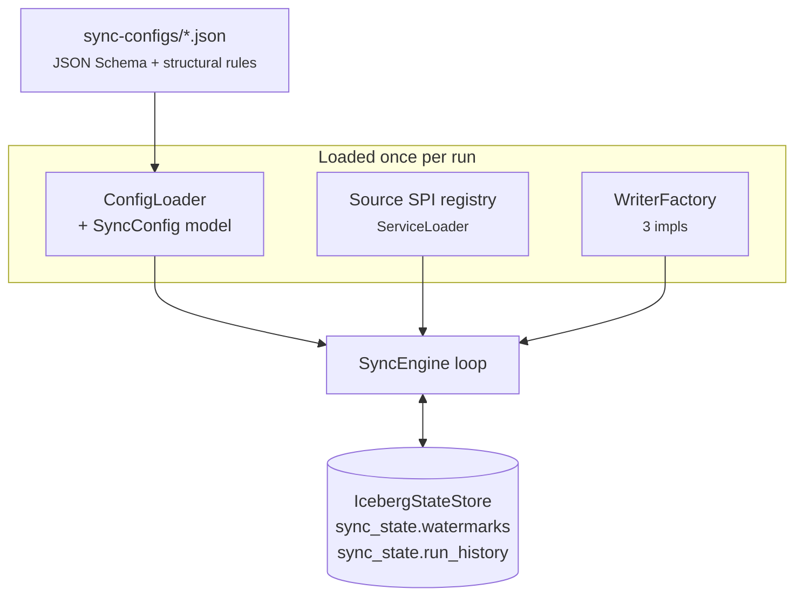
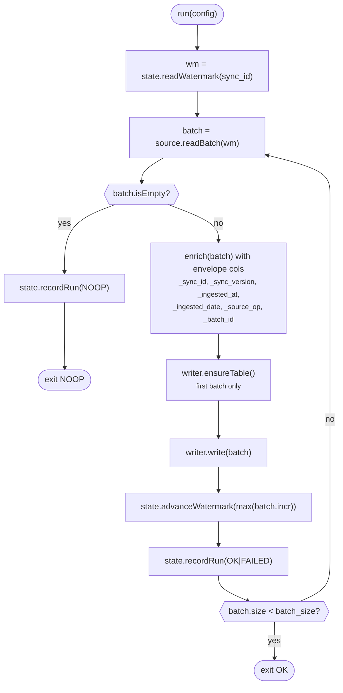

# warehouse-sync architecture

## Guiding principles

Same philosophy as [structured-logger](../structured-logger/): **the configuration file is the source of truth**, engine code is generic, and every runtime concern (schema, partitioning, transport, target table) is data, not code. Adding a table to sync should never require a code change.

Two things are different from structured-logger:

1. **Pull, not push.** Structured-logger is a library embedded in producer apps. warehouse-sync is a scheduled reader that owns the connection to the source database.
2. **Direct-to-warehouse.** No Kafka in the hot path (though a Debezium-Kafka source is stubbed as future work). One-shot Spark job → Iceberg → done.

## Runtime shape

Component wiring:



Engine loop per config, per run:



## Data flow, per batch

1. **Read watermark.** Engine asks StateStore for the last successfully-committed value of `incremental_column` for this `sync_id`. On first run this comes back UNSET.
2. **Build SELECT.** `PostgresSource.buildSubquery()` produces:
   ```sql
   SELECT "col1", "col2", ...
     FROM "public"."users"
    WHERE "updated_at" > TIMESTAMP '2026-01-15T10:00:00Z'
      AND "updated_at" < NOW() - INTERVAL '5 seconds'   -- if lag configured
    ORDER BY "updated_at" ASC
    LIMIT 10000
   ```
   For `mode=full_replace` this is just `SELECT ... FROM ...` with no WHERE/LIMIT.
3. **JDBC read via Spark.** The subquery is passed to Spark's built-in JDBC datasource as the `dbtable` option so Postgres runs the filter and ordering server-side.
4. **Envelope enrichment.** The engine adds six metadata columns to the Dataset before handing it to the writer:
   `_sync_id`, `_sync_version`, `_ingested_at`, `_ingested_date`, `_source_op` (`UPSERT` or `SNAPSHOT`), `_batch_id`. Mirrors the structured-logger envelope idea but flattens to typed columns because the target is Iceberg not JSON.
5. **Write.** Writer dispatched by `mode`:
   - `AppendOnlyWriter` → `outputDataset.writeTo(table).append()`
   - `MergeWriter` → registers a temp view, runs `MERGE INTO target t USING v s ON t.pk=s.pk WHEN MATCHED UPDATE SET ... WHEN NOT MATCHED INSERT ...`
   - `FullRefreshWriter` → `outputDataset.writeTo(table).createOrReplace()`
6. **Advance state.** New `max(incremental_column)` written to `watermarks`. `run_history` gets an append row with duration, row count, status.
7. **Loop or exit.** If `batch.rowCount == batch_size` there might be more; loop back to step 1 with the new watermark. Otherwise exit.

## Concurrency / correctness

- **Watermark advance is post-commit.** If the writer throws, the watermark is not moved and the state store gets a `FAILED` run record with the error. Next run re-reads the same rows and tries again. Idempotency guarantees vary by writer:
  - `merge` — safe (upsert-on-pk is naturally idempotent).
  - `append_only` — will double-write on retry. If this matters, use `merge` on a synthetic PK, or ensure the source `id` is unique per row and dedupe downstream.
  - `full_replace` — always overwrites, so retries are safe.
- **`serve` concurrency lock.** Each `sync_id` has a `ReentrantLock`; a second scheduled tick that finds a run still in flight is skipped and logged. Prevents overlapping batches from racing on the state store.
- **Graceful shutdown.** SIGTERM handler stops accepting new ticks, waits up to 30s per sync for in-flight runs to drain, then releases the main-thread latch. Kill -9 leaves state consistent because watermarks only advance after commits.
- **Watermark lag.** For `timestamp` incremental columns, `schedule.watermark_lag_seconds` adds `AND col < NOW() - INTERVAL 'N seconds'` to the WHERE clause. Avoids racing with in-flight source-side transactions that would otherwise get skipped if their commit lands between two `max()` reads.

## Source SPI

```java
public interface Source extends AutoCloseable {
    SourceBatch readBatch(SparkSession spark, SyncConfig config, Watermark previousWatermark);
}

public interface SourceFactory {
    String type();                      // config discriminator
    void   validate(SyncConfig config); // preflight, no I/O
    Source create(SyncConfig config);
}
```

Discovered via `ServiceLoader<SourceFactory>`. Three factories ship:

| type | Factory | State |
|---|---|---|
| `postgres` | `PostgresSourceFactory` | production-ready |
| `mysql` | `MySqlSourceFactory` | validate() works, create() throws — near-clone of Postgres to finish |
| `debezium-kafka` | `DebeziumKafkaSourceFactory` | validate() works, create() throws — CDC seam, class javadoc has the wiring recipe |

## Write modes decision matrix

| Situation | Mode | Why |
|---|---|---|
| Source rows are immutable (event logs, orders after placement) | `append_only` | Cheapest; each batch is a straight append |
| Source rows are edited in place, deletes rare or irrelevant | `merge` | Iceberg MERGE keeps target current on PK |
| Source table is small, deletes matter, or you don't have a good watermark | `full_replace` | Whole-table snapshot each run; catches drift |
| Rows are edited AND deletes matter | `merge` + `full_refresh_cadence: 24h` | Merge every schedule tick, full replace nightly to catch deletes |

## State store schema

**`iceberg.sync_state.watermarks`** — one row per `sync_id` (latest wins).

| column | type | notes |
|---|---|---|
| `sync_id` | STRING | PK-like (deleted+reinserted on update) |
| `watermark_value` | STRING | Canonical string form; type below drives interpretation |
| `watermark_type` | STRING | `timestamp` \| `long` \| `int` \| `date` \| `string` |
| `updated_at` | TIMESTAMP | When advanced |

**`iceberg.sync_state.run_history`** — append-only audit log, partitioned by `days(started_at)`.

| column | type | notes |
|---|---|---|
| `run_id` | STRING | UUID |
| `sync_id` | STRING | FK to watermarks |
| `started_at` | TIMESTAMP | |
| `finished_at` | TIMESTAMP | |
| `rows_synced` | BIGINT | Sum across all batches in this run |
| `status` | STRING | `OK` \| `NOOP` \| `FAILED` |
| `error_message` | STRING | populated iff FAILED |
| `watermark_before` | STRING | |
| `watermark_after` | STRING | |
| `mode` | STRING | Write mode used (respected `--force-full-refresh` override) |

Both tables live in the same catalog as the warehouse data, so Trino can query them directly:

```sql
SELECT sync_id, status, rows_synced, watermark_before, watermark_after
  FROM iceberg.sync_state.run_history
 WHERE started_at > NOW() - INTERVAL '1' DAY
 ORDER BY started_at DESC;
```

## Envelope columns

Mirrors structured-logger's envelope pattern (metadata alongside data), flattened to typed columns because the target is columnar:

| column | type | purpose |
|---|---|---|
| `_sync_id` | STRING | Which config produced this row |
| `_sync_version` | STRING | Config version at time of write — helpful when a version bump changes column meanings |
| `_ingested_at` | TIMESTAMP | Wall-clock at engine batch-start |
| `_ingested_date` | DATE | UTC date derived from `_ingested_at`, natural partition key |
| `_source_op` | STRING | `UPSERT` (from append_only/merge) or `SNAPSHOT` (from full_replace) |
| `_batch_id` | STRING | UUID per SyncEngine batch — groups all rows written in one write() call, useful for debugging partial batches |

## Comparison with structured-logger

| Concern | structured-logger | warehouse-sync |
|---|---|---|
| Direction | App code pushes rows | Engine pulls rows |
| Transport | Kafka (+ multi-sink support) | JDBC direct; Kafka possible via Debezium plugin |
| Schema definition | JSON config → codegen typed loggers | JSON config → runtime SELECT + Spark schema inference |
| Warehouse landing | Spark Structured Streaming | Batch Spark (one job per run) |
| Envelope | JSON wrapper `{_log_type, _version, data}` | Flat Iceberg columns `_sync_id, _sync_version, _ingested_at, ...` |
| Adding a new source | New logger config, regen code | New config alone (or new SourceFactory for a new database type) |
| State | Kafka consumer offsets | Iceberg watermark table |
| Scheduling | Continuous consumer | One-shot CLI + optional daemon |

Both projects share the same lakehouse (`../spark_minio_trino`), the same port-remap discipline, and the same `mode: metadata-driven config → generic engine → Iceberg` mental model.
