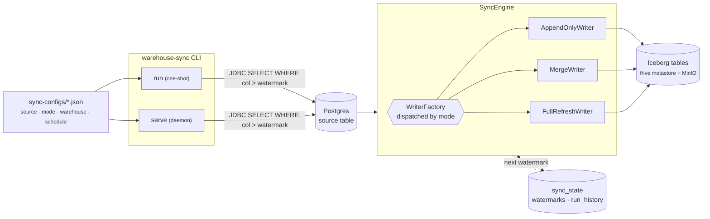

# warehouse-sync

Metadata-driven incremental replication from operational databases (Postgres today, MySQL/CDC pluggable) into an Apache Iceberg warehouse. Sister project to [structured-logger](../structured-logger/) — same lakehouse stack, same config-driven ethos, but reads from database tables instead of application log calls.

> **Status:** v0.1.0 — Postgres source, all three write modes, one-shot + daemon runtimes, Iceberg-backed watermark state, dry-run/inspect/backfill CLIs, JSON-Schema-validated configs, MySQL + Debezium source stubs proving the SPI seam.

## Docs

- **[QUICKSTART.md](QUICKSTART.md)** — zero to first row in the warehouse in five minutes.
- **[DEMO.md](DEMO.md)** — walkthrough of the interactive playground and the one-shot demo. Read this if you want to see it doing something interesting.
- **[RUNNING.md](RUNNING.md)** — every CLI subcommand, JVM/env setup, common workflows, cluster + cron + systemd deployment.
- **[CONFIGURATION.md](CONFIGURATION.md)** — every config field explained, mode decision matrix, envelope columns, common gotchas, example gallery.
- **[ARCHITECTURE.md](ARCHITECTURE.md)** — engine internals, concurrency model, state store schema, comparison with structured-logger.

## Design at a glance



- **Source SPI** — one interface (`Source`), one config discriminator (`source.type`), ServiceLoader-discovered factories. Adding a new source type is one new class + one line in `META-INF/services`.
- **Write modes** — per-table choice of `append_only`, `merge` (Iceberg MERGE INTO on primary key), or `full_replace` (atomic swap). Modes are dispatched by the writer factory; the engine doesn't know which is running.
- **Watermark** — declared `incremental_column` on the source. Engine reads `WHERE incremental_column > last_watermark ORDER BY incremental_column ASC LIMIT batch_size` and advances to `max(incremental_column)` after each successful batch.
- **State store** — Iceberg tables under a `sync_state` namespace (`watermarks`, `run_history`). Self-contained, queryable via Trino for debugging.

## Directory layout

| Path | Contents |
|---|---|
| `sync-configs/` | The metadata driving each replication job |
| `config-schema/` | JSON Schema — validate configs before shipping |
| `src/main/java/com/warehouse/sync/` | Engine, source SPI, writers, state store, CLI |
| `docker-compose.yml` + `lakehouse-override.yml` | Local demo stack (needs sibling `../spark_minio_trino`) |
| `scripts/` | Stack lifecycle + Postgres seed + Trino queries |
| `demo/demo-end-to-end.sh` | Full walkthrough — mirrors structured-logger's demo pattern |

## Config example

```json
{
  "name": "UsersSync",
  "sync_id": "users_sync",
  "version": "1.0.0",
  "source": {
    "type": "postgres",
    "connection": {
      "host_env": "SOURCE_PG_HOST", "port_env": "SOURCE_PG_PORT",
      "database_env": "SOURCE_PG_DB", "user_env": "SOURCE_PG_USER",
      "password_env": "SOURCE_PG_PASSWORD"
    },
    "schema": "public", "table": "users",
    "columns": ["id", "email", "display_name", "created_at", "updated_at"],
    "primary_key": ["id"],
    "incremental_column": "updated_at",
    "incremental_column_type": "timestamp"
  },
  "mode": "merge",
  "warehouse": {
    "table_name": "warehouse.public_users",
    "target_catalog": "iceberg",
    "sort_by": ["id"]
  },
  "schedule": {
    "cadence": "5m",
    "batch_size": 10000,
    "full_refresh_cadence": "24h",
    "watermark_lag_seconds": 5
  }
}
```

Structural rules enforced beyond JSON Schema:

| Rule | Reason |
|---|---|
| `mode=merge` requires `primary_key` + `incremental_column` | Merge is upsert on PK; watermark drives batching |
| `mode=append_only` requires `incremental_column` | Otherwise there's no batching cursor |
| `mode=full_replace` requires neither | Whole-table snapshot every run |

## CLI

```
warehouse-sync validate-config --config sync-configs/          # or one file
warehouse-sync dry-run         --config sync-configs/users_sync.json
warehouse-sync run             --config sync-configs/users_sync.json
warehouse-sync run             --config sync-configs/ --force-full-refresh
warehouse-sync serve           --config-dir sync-configs/
warehouse-sync inspect                                          # or --sync-id
warehouse-sync backfill        --config … --reset               # or --watermark <v>
```

`run` is one-shot (cron/systemd/k8s CronJob friendly). `serve` is a long-running JVM with an embedded scheduler (cron4j at minute granularity; internal ScheduledExecutorService for sub-minute cadences). Both share every other subsystem — no fork.

## Local dev

Prereqs:
- Docker (Rancher Desktop / Docker Desktop / Colima)
- JDK 11+ (JDK 21 tested; the launcher script adds required `--add-opens` for Spark 3.5)
- Maven 3.9+
- [spark_minio_trino](https://github.com/…) available at `../spark_minio_trino`, or `export SPARK_MINIO_TRINO_DIR=/path/to/it`

```bash
./scripts/start-stack.sh          # lakehouse + demo source-postgres
mvn -DskipTests package           # builds target/warehouse-sync-0.1.0-all.jar
./scripts/seed-postgres.sh        # create some churn to replicate

# Use the bin/warehouse-sync launcher (adds JDK 21 opens + UTC timezone).
# Direct `java -jar` also works but you need to pass those flags yourself.
./bin/warehouse-sync dry-run --config sync-configs/users_sync.json
./bin/warehouse-sync run     --config sync-configs/                  # all three
./bin/warehouse-sync inspect
./scripts/query-warehouse.sh iceberg "SELECT * FROM iceberg.warehouse.public_users LIMIT 10"
```

Or the whole walkthrough in one command:

```bash
./demo/demo-end-to-end.sh
```

## Tests

```
mvn test                # unit tests (16 tests, sub-second)
mvn verify              # + integration tests (testcontainers → Postgres + Spark)
```

**19/19 pass locally on JDK 21 + Rancher Desktop.**

Integration tests need a Docker daemon reachable at `$DOCKER_HOST` (or `~/.testcontainers.properties`). On Rancher Desktop specifically:
- `~/.testcontainers.properties` needs `docker.host=unix:///Users/$USER/.rd/docker.sock`, `ryuk.disabled=true`
- `~/.docker-java.properties` needs `api.version=1.43` (Rancher's daemon rejects docker-java's default `1.32` probe)
- Symlink `/var/run/docker.sock` → `/Users/$USER/.rd/docker.sock` so testcontainers' Unix strategy finds it

Docker Desktop and Colima work out of the box.

## Adding a new source type

1. Write `MyThingSource implements Source` — one `readBatch(spark, cfg, previousWatermark)` method.
2. Write `MyThingSourceFactory implements SourceFactory` — `type()`, `validate()`, `create()`.
3. Add the factory class name to `src/main/resources/META-INF/services/com.warehouse.sync.source.SourceFactory`.
4. Configs reference it via `"source": { "type": "mything", … }`.

Two stubs ship as proof: `MySqlSourceFactory` and `DebeziumKafkaSourceFactory`. Both pass `validate-config` — only their `create()` throws until someone fleshes out the reader.

## What's next

- Real `MySqlSource` — near-clone of `PostgresSource` with different JDBC URL and identifier quoting.
- Real `DebeziumKafkaSource` — consume Debezium change events from Kafka, treat LSN as the watermark. Wiring recipe is in the class javadoc.
- Web UI for config editing (optional; not planned).
- Metrics: emit sync duration + rows + errors to Prometheus so `serve` is monitorable.

See [ARCHITECTURE.md](ARCHITECTURE.md) for the design in more depth.
